# AgentOp

**A terminal dashboard for AI coding agents** — Claude limits, token spend, token speed and system health in one live TUI. Think `top`, but for your agents + machine.

```
╭─ ● AGENTOP 1.4.0 · catppuccin-mocha ─────────────── 15:42:07 · 88% · 46°C · up 30м ─╮
│ ▐ LIMITS ───────────────────────────────────── │ ▐ CPU ────────────────────────────────────── │
│   5h  ░░░░░░░░░░░░ 0.000%  ↻ 4ч 32м            │   total ██░░░░░░░░░░  15%  ▁                  │
│   7d  ███░░░░░░░░░ 23.000%  ↻ 14ч 02м          │   C0 █████ 100  C1 ░░░░░   2  C2 ░░░░░   9   │
│ ▐ ТОКЕНЫ · СЕГОДНЯ ─────────────────────────── │   C3 ░░░░░   0  C4 █░░░░  30  C5 ░░░░░   2   │
│   Claude   0 in · 0 out · 0 cache              │   C6 ░░░░░   7  C7 ░░░░░   0  C8 █░░░░  14   │
│   opencode 140.2K in · 47.3K out · $0.401      │   load 0.51 0.53 0.40  ▁                     │
│ ▐ СКОРОСТЬ ТОКЕНОВ ─────────────────────────── │ ▐ ПАМЯТЬ · ТЕМПЕРАТУРА · GPU ─────────────── │
│   now 101.13 tok/s  peak 173.42                │   RAM  ██░░░░░░░░  19%  2.8/14.9G  swap 0.0/4 │
│   ▁▁▁▁▁▁▁▁▁▁▁▁▁▁▁▁▁▃▂▁█▁▁▅▂▄▄▄▄▃              │   temp ███░░░░░░░  49°C  ▁                   │
│                                                │   GPU  ░░░░░░░░░░   0%  gpu 47°C             │
│                                                │ ▐ ПИТАНИЕ ─────────────────────────────────── │
│                                                │   BAT ███████████████░  93%  разряд          │
│                                                │ ▐ ДИСК · СЕТЬ ─────────────────────────────── │
│                                                │   disk ██░░░░░░░░░░ 38/196G  r 0B/s  w 0B/s  │
│                                                │   net  ↓ 7.7K/s  ↑ 5.4K/s  wlp2s0            │
╰─ [r] обновить   [t] тема   [p] пауза   [q] выход ─────────────────────────────────╯
```

## Features

- **Claude limits** — the official 5-hour and weekly windows, with reset countdown and a `pace` forecast (how much of the quota you will have used by reset at the current rate).
- **Token spend today** — input / output / cache tokens and cost for [Claude Code](https://claude.com/claude-code) and [opencode](https://opencode.ai).
- **Token speed** — now / 1 min / 5 min / peak, with a gradient sparkline or a multi-line Braille graph on tall terminals.
- **System** — total + per-core CPU, load average, RAM/swap, CPU temp, GPU load/temp, battery (charge, power, time left), disk usage + I/O, network throughput.
- **Themes** — `catppuccin-mocha`, `catppuccin-latte`, `dracula`, `nord`, `gruvbox`, `tokyo-night`, `solarized-dark`, `matrix`, `mono`, plus `auto` (follows the GNOME light/dark scheme).
- **Two layouts** — a two-column dashboard on wide terminals (≥96 cols), a single clean column on narrow ones.
- **Low overhead** — ~0.4 % CPU, ~40 MB RAM, one wakeup per second, redraws only when data changes. Press `p` to pause (0 % CPU).
- **Per-model spend** — today's usage per model (opus/sonnet, deepseek-flash/v4-pro); for Claude, what it would cost at API prices (5 min / 1 h cache writes and fast mode included).
- **Limit trend** — a limits log (`~/.cache/agentop/limits_history.jsonl`, 8 days) drives a sparkline of the current window and a forecast at reset based on the last 30 minutes.
- **Notifications** — `notify-send` at 80 % and 95 % of a window, once per window.
- **Machine-readable** — `--short` (one line), `--json`, `--waybar` (Waybar custom module) and `--argos` (GNOME top bar via the Argos extension).
- **Russian keyboard layout** — hotkeys work on ЙЦУКЕН too (`к` = `r`, `й` = `q`, …).
- **Task manager** — processes grouped by app, search, sort, end with confirmation.
- **16 views** — from the classic dashboard to gauges, a fuel tank, a live response feed and a weekly heatmap.

## Quick start

```bash
git clone https://github.com/avgustenko/agentop && cd agentop
./install.sh     # agentop in ~/.local/bin, app menu entry, GNOME top bar extension
agentop
```

Log out and back in once (Wayland) to load the top bar indicator.

## How to use

1. Run `agentop`. 2. Press `v` / `V` to switch views (the choice is remembered). 3. Watch the 5h row: usage, reset time and the forecast at reset; you get a notification at 80% and 95%. 4. To end a frozen app: `d`, select it, `x`, `y` (SIGKILL is offered if it is still running after 3 s). 5. `s` opens settings.

## View gallery

Rendered from sample data with `python3 docs/make_screenshots.py`.

| | |
|---|---|
| **Dashboard** · `dashboard`<br>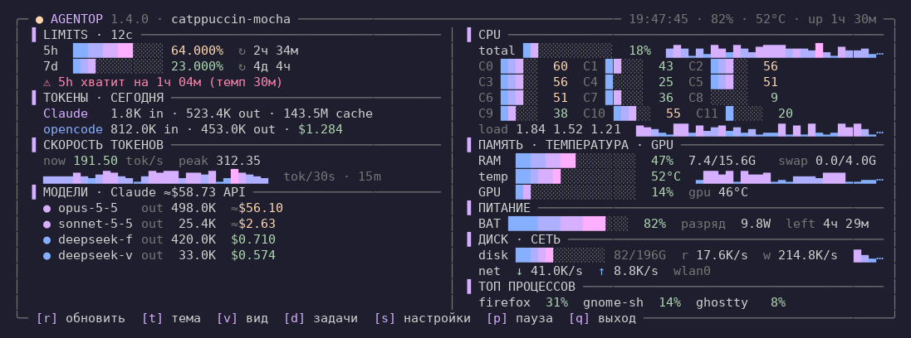 | **Window timeline** · `timeline`<br>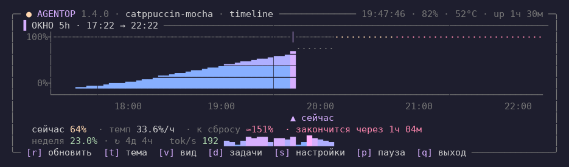 |
| **Gauges** · `gauges`<br>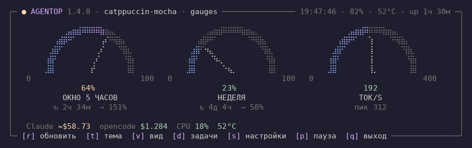 | **Fuel tank** · `fuel`<br>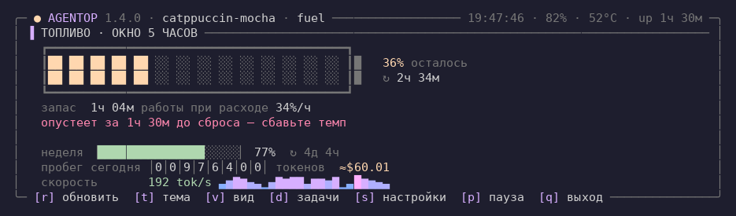 |
| **Brief** · `brief`<br>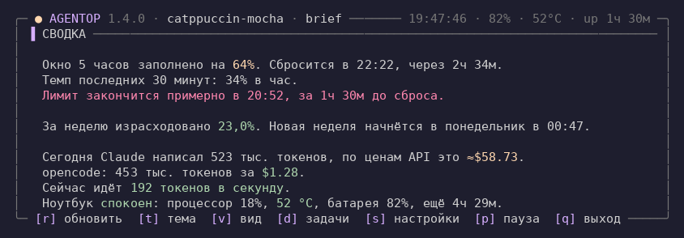 | **Response feed** · `feed`<br>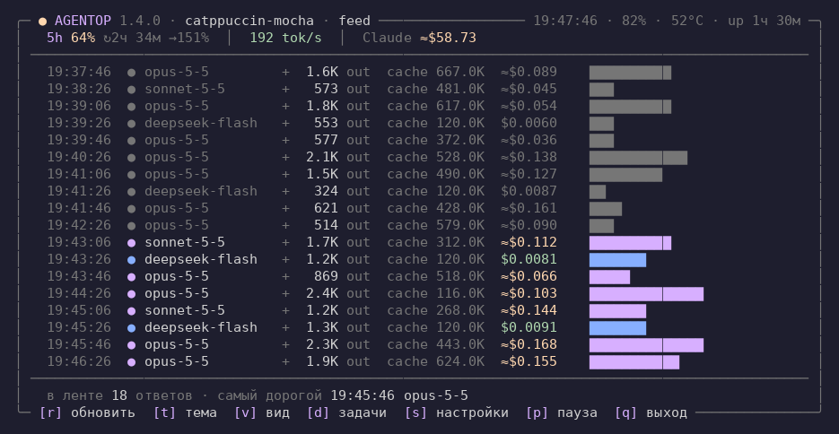 |
| **Week heatmap** · `week`<br>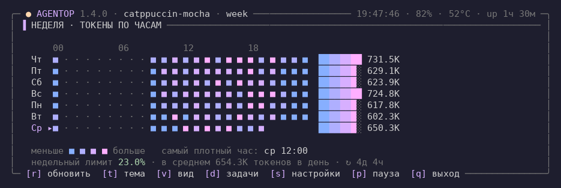 | **Tiles** · `tiles`<br>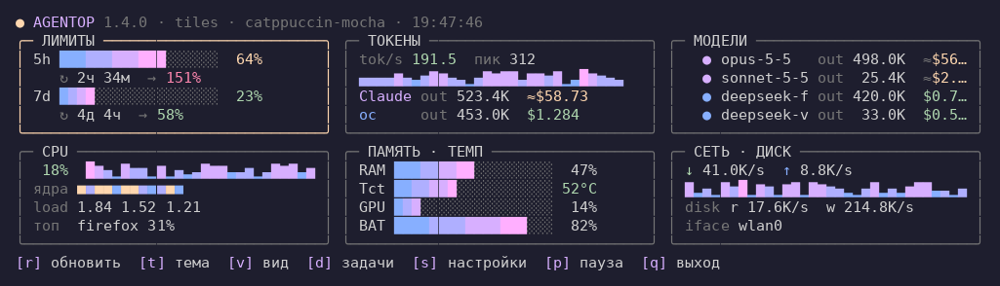 |
| **Cockpit** · `cockpit`<br>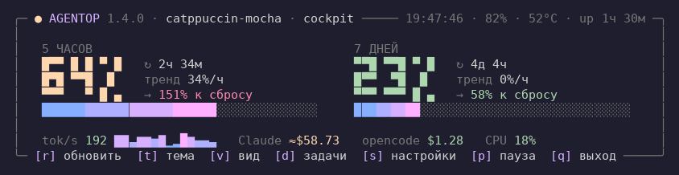 | **Task manager** · `tasks`<br>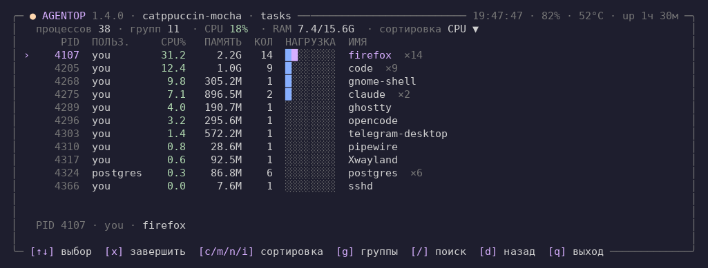 |
| **Sidebar** · `sidebar`<br>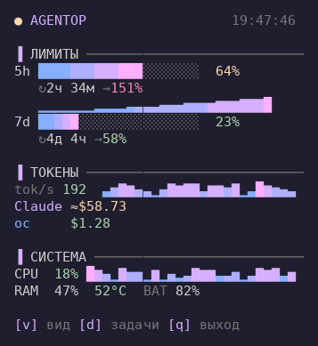 | **Beacon** · `beacon`<br>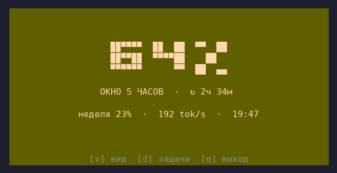 |
| **Focus** · `focus`<br>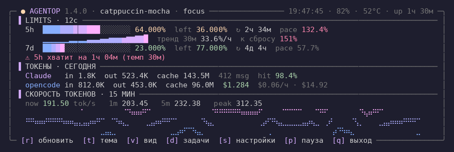 | **System** · `system`<br>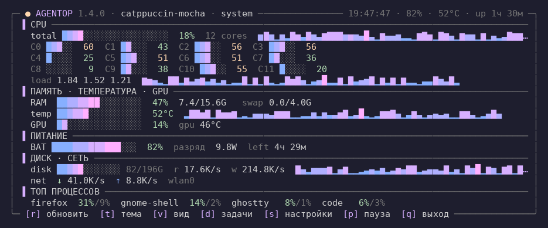 |
| **Compact** · `compact`<br>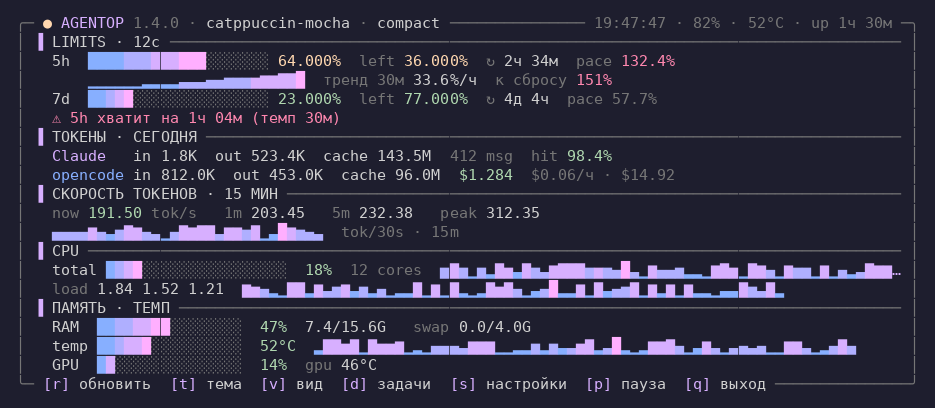 | **Minimal** · `minimal`<br>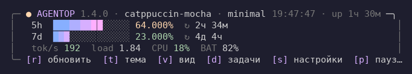 |

## GNOME top bar

`gnome-extension/agentop@avgustenko` (GNOME 45–50) shows the limit in the top bar; the menu has a 5h window chart with the forecast, the weekly window, today's cost and buttons to open AgentOp or the task manager. Nine indicator styles are selectable from the menu. It polls `agentop --json` every 30 s and does no networking itself.

## Settings

Press `s` in the live view. Change the refresh interval from **0.01 s to 300 s**, theme, view, sparkline history, decimals and which sections to show. Changes are saved to `~/.config/agentop/config.json` immediately.

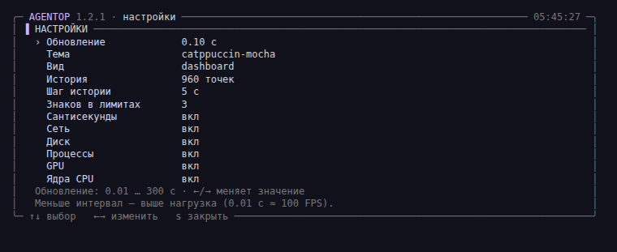

## Themes

`auto` follows the GNOME light/dark scheme. Switch with `t`, `--theme` or `--set-theme`.

| | |
|---|---|
| **Catppuccin Mocha**<br>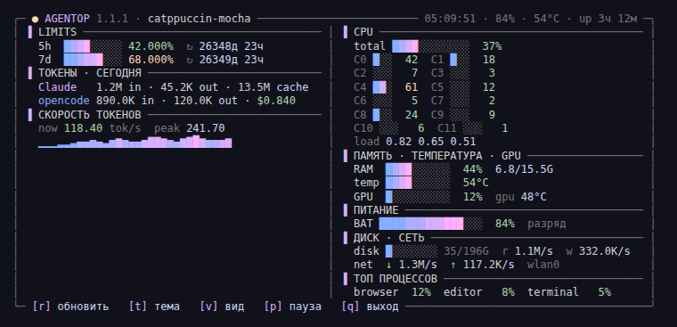 | **Catppuccin Latte**<br>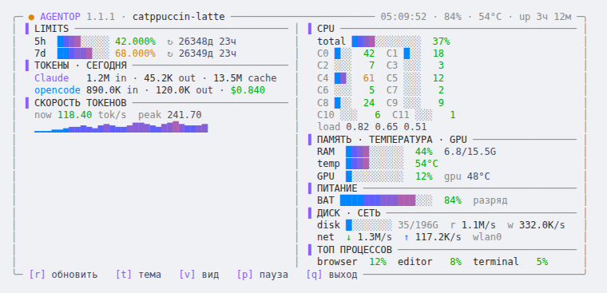 |
| **Dracula**<br>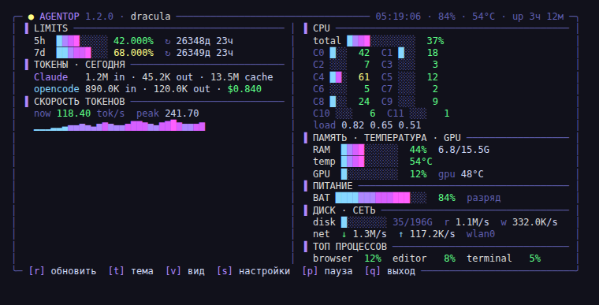 | **Nord**<br>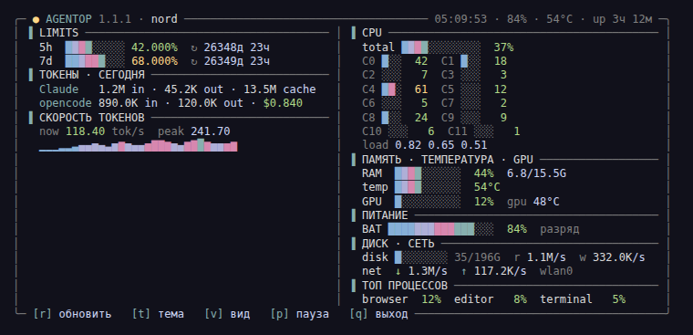 |
| **Gruvbox**<br>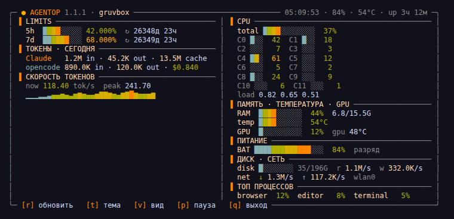 | **Tokyo Night**<br>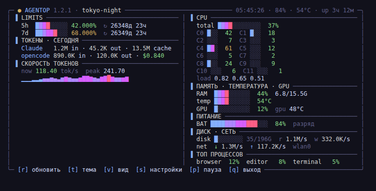 |
| **Matrix**<br>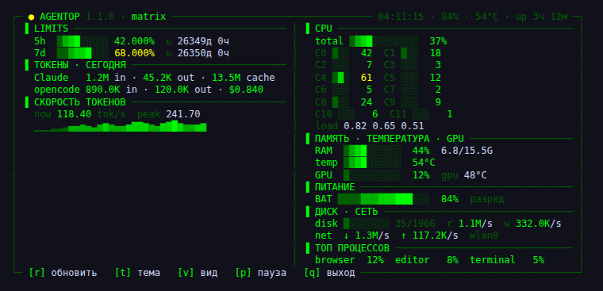 | **Mono**<br>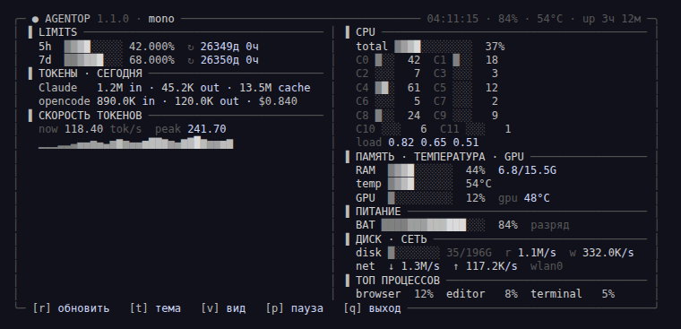 |

## Requirements

- Linux (reads `/proc` and `/sys`), Python 3.9+
- `ps` from `procps` (for the top-processes section)
- Optional: Claude Code (`~/.claude`) for limits/tokens, opencode for its stats, `gsettings` for `auto` theme

## Install

```bash
git clone https://github.com/avgustenko/agentop.git
cd agentop
./install.sh
```

The installer copies `agentop` to `~/.local/bin` and adds a desktop entry. Make sure `~/.local/bin` is in your `PATH`.

### Manual

```bash
install -m 755 agentop ~/.local/bin/agentop
agentop
```

## Usage

```bash
agentop                 # live dashboard
agentop --short         # one line (status bar / prompt)
agentop --json          # machine-readable snapshot
agentop --waybar        # Waybar custom module JSON
agentop --argos         # GNOME top bar (Argos extension)
agentop --once          # render once and exit
agentop -i 2            # refresh every 2 s (default 1 s)
agentop --theme nord    # theme for this run
agentop --set-theme nord
agentop --list-themes
agentop --view focus    # view for this run
agentop --list-views
agentop --refresh       # drop caches, refetch limits
agentop --config        # show config path + contents
agentop --ms            # centisecond clock, ~100 FPS (heavy)
agentop --version
```

In the live view:

| Key | Action |
|---|---|
| `r` | refresh now (caches + limits) |
| `t` | next theme (saved to config) |
| `v` | next view (saved to config) |
| `s` | settings screen (interval 0.01–300 s) |
| `p` | pause / resume (0 % CPU while paused) |
| `q` | quit |

## Task manager

Press `d` (or `agentop --view tasks`) for a process list with current CPU, memory and owner, grouped by application by default (all browser processes are one row).

| Key | Action |
|---|---|
| `↑` `↓` `PgUp` `PgDn` `Home` `End` | move |
| `x` / `Del` | end the selected app (asks first) |
| `y` / `K` / `n` | in the prompt: end / force / cancel |
| `c` `m` `n` `i` | sort by CPU, memory, name, PID (again to reverse) |
| `g` | toggle grouping |
| `/` | filter by name or PID |
| `d` / `Esc` | back |

Ending works like a system monitor: SIGTERM first; if the app is still running after 3 seconds, AgentOp offers SIGKILL. AgentOp itself, init and kernel threads are blocked; the terminal running AgentOp, session-critical processes and other users' processes get a warning.

## Views

`v` / `V` cycle views; `agentop --list-views` lists them: `dashboard`, `focus`, `timeline`, `gauges`, `fuel`, `brief`, `feed`, `week`, `tiles`, `cockpit`, `sidebar` (auto on terminals narrower than 52 columns), `beacon`, `tasks`, `system`, `compact`, `minimal`.

## Configuration

`~/.config/agentop/config.json` is created on first run. See [`config.example.json`](config.example.json):

```json
{
  "theme": "auto",
  "view": "dashboard",
  "interval": 1.0,
  "history": 120,
  "history_interval": 2.0,
  "limit_decimals": 3,
  "clock_ms": false,
  "notify": true,
  "notify_thresholds": [80, 95],
  "show": {"network": true, "disk": true, "processes": true, "gpu": true, "per_core": true,
           "models": true}
}
```

- `interval` — UI tick, seconds.
- `history` × `history_interval` — length of sparkline history.
- `limit_decimals` — decimals for limit percentages (the API currently returns whole percents, so you'll see `.000`).
- `show.*` — toggle sections.
- `notify`, `notify_thresholds` — limit notifications (thresholds in %).
- `panel_style` — top bar indicator for `--argos`: `text`, `forecast`, `dot`, `cells`, `countdown`, `pulse`, `rotate`, `ring` (PNG ring), `bars` (PNG bars). One-off: `--panel-style ring`.
- `prices` — override built-in prices: `{"claude-opus-5-5": [input, output, cache write 5m, cache read]}`, USD per 1M tokens.

### GNOME top bar (Argos)

Install the [Argos](https://github.com/p-e-w/argos) extension and create `~/.config/argos/agentop.30s.sh`:

```bash
#!/usr/bin/env bash
exec ~/.local/bin/agentop --argos
```

### Waybar

```json
"custom/agentop": {"exec": "agentop --waybar", "return-type": "json", "interval": 30}
```

## How it works

| Data | Source |
|---|---|
| Claude limits | `https://api.anthropic.com/api/oauth/usage` using your local Claude Code OAuth token (the same endpoint `/usage` uses). Fetched every 30 s in a background thread; `r` forces an immediate refresh. The LIMITS title shows the data age. |
| Claude tokens | `~/.claude/projects/**/*.jsonl` (incremental tail, deduplicated by `requestId` + `message.id`) |
| opencode tokens/cost | `~/.local/share/opencode/opencode.db` (SQLite, read-only) |
| Hardware | `/proc/stat`, `/proc/meminfo`, `/proc/diskstats`, `/proc/net/route`, `/sys/class/*` |

**Privacy:** no telemetry. The OAuth token is read locally and sent only to Anthropic; it is never printed or written to the cache. Caches contain numbers only and are created with `0600` permissions.

## Notes

- The TUI labels are currently in Russian. The code and docs are English-friendly; PRs for i18n are welcome.
- The limit API returns whole percents, so `xxx.xxx%` currently shows `.000` after the dot.
- On `HTTP 429` the widget keeps the last successful limits response and backs off.
- The Claude "API price" figure is an estimate for comparison with your subscription, not a bill.
- Claude log parsing and the limits request are the only non-trivial operations; both are cached and/or backgrounded.

## Tests

```bash
python3 -m unittest discover -s tests -v
```

56 tests, including the task manager (ending a real process, SIGTERM → SIGKILL fallback, self-protection), every view at several terminal sizes and panel styles. Earlier: formatting, ANSI/clip/pad, theme bars, sparklines, Braille graphs, settings, all views, key input (UTF-8, Russian layout, EOF), pricing, the limits log and trend, notifications, Waybar/Argos output and CLI smoke tests. Tests run with a temporary `HOME`, so they never read your logs or call the API with your token. CI runs them on every push.

## License

[MIT](LICENSE)
