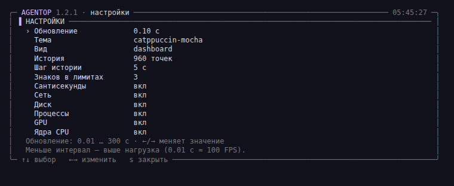
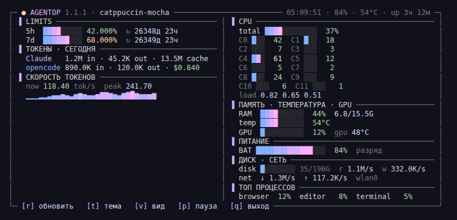
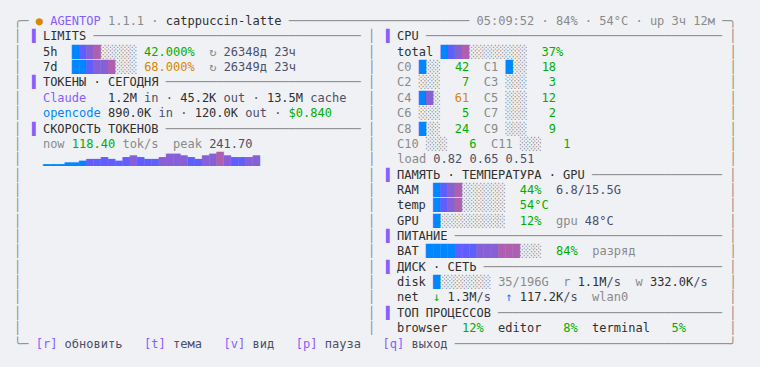
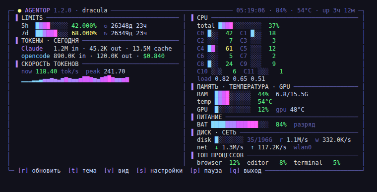
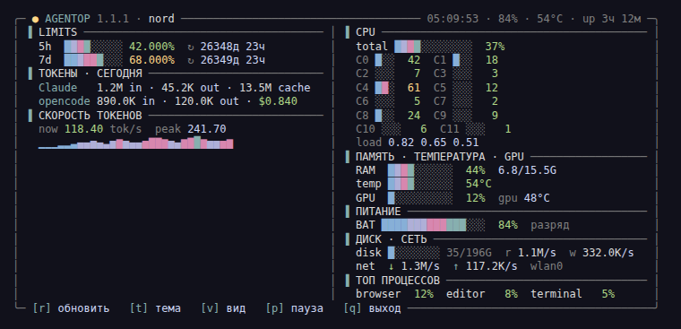
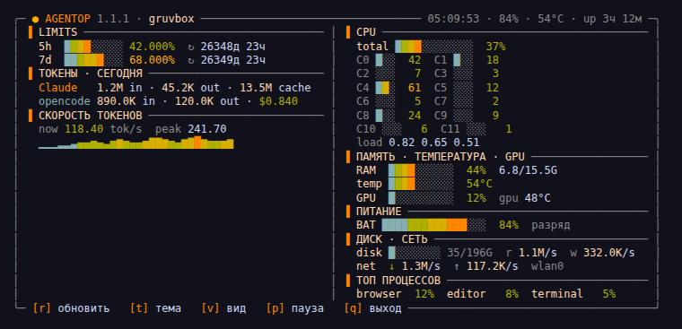
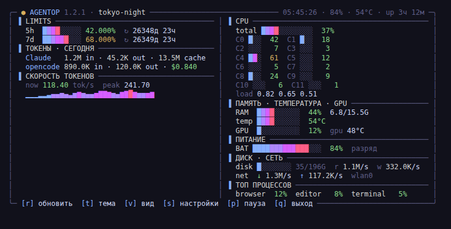
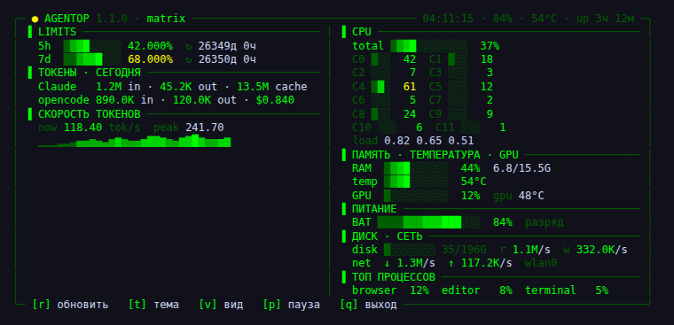
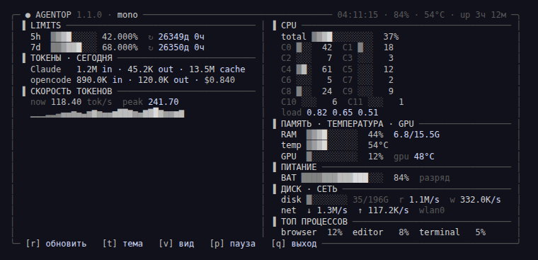

# AgentOp

**Терминальный дашборд для AI-агентов**: лимиты Claude, расход токенов, скорость токенов и здоровье системы в одном живом TUI. Этакий `top`, но для агентов и железа.

```
╭─ ● AGENTOP 1.4.0 · catppuccin-mocha ─────────────── 15:42:07 · 88% · 46°C · up 30м ─╮
│ ▐ LIMITS ───────────────────────────────────── │ ▐ CPU ────────────────────────────────────── │
│   5h  ░░░░░░░░░░░░ 0.000%  ↻ 4ч 32м            │   total ██░░░░░░░░░░  15%  ▁                  │
│   7d  ███░░░░░░░░░ 23.000%  ↻ 14ч 02м          │   C0 █████ 100  C1 ░░░░░   2  C2 ░░░░░   9   │
│ ▐ ТОКЕНЫ · СЕГОДНЯ ─────────────────────────── │   C3 ░░░░░   0  C4 █░░░░  30  C5 ░░░░░   2   │
│   Claude   0 in · 0 out · 0 cache              │   C6 ░░░░░   7  C7 ░░░░░   0  C8 █░░░░  14   │
│   opencode 140.2K in · 47.3K out · $0.401      │   load 0.51 0.53 0.40  ▁                     │
│ ▐ СКОРОСТЬ ТОКЕНОВ ─────────────────────────── │ ▐ ПАМЯТЬ · ТЕМПЕРАТУРА · GPU ─────────────── │
│   now 101.13 tok/s  peak 173.42                │   RAM  ██░░░░░░░░  19%  2.8/14.9G  swap 0.0/4 │
│   ▁▁▁▁▁▁▁▁▁▁▁▁▁▁▁▁▁▃▂▁█▁▁▅▂▄▄▄▄▃              │   temp ███░░░░░░░  49°C  ▁                   │
│                                                │   GPU  ░░░░░░░░░░   0%  gpu 47°C             │
╰─ [r] обновить   [t] тема   [p] пауза   [q] выход ─────────────────────────────────╯
```

## Возможности

- **Лимиты Claude** — официальные 5-часовое и недельное окна, время сброса и `pace` — прогноз расхода к моменту сброса.
- **Токены за сегодня** — in/out/cache и стоимость для [Claude Code](https://claude.com/claude-code) и [opencode](https://opencode.ai).
- **Скорость токенов** — now / 1 мин / 5 мин / peak, градиентный спарклайн или многострочный Braille-график.
- **Система** — CPU (общий и по ядрам), load average, RAM/swap, температура, GPU, батарея, диск, сеть.
- **Темы** — 9 штук + `auto` по схеме GNOME.
- **Два макета** — две колонки на широких терминалах (≥96), одна на узких.
- **Низкая нагрузка** — ~0.4 % CPU, ~40 МБ RAM, 1 пробуждение/с. `p` — пауза (0 % CPU).
- **Модели** — расход за сегодня по каждой модели (opus/sonnet, deepseek-flash/v4-pro); для Claude — сколько это стоило бы по ценам API (с учётом кэша 5 мин/1 ч и fast mode).
- **Тренд лимитов** — журнал лимитов (`~/.cache/agentop/limits_history.jsonl`, 8 дней): мини-график текущего окна и прогноз к сбросу по темпу последних 30 минут.
- **Уведомления** — `notify-send` при 80 % и 95 % окна, один раз за окно.
- **Машинный вывод** — `--short`, `--json`, `--waybar` (модуль custom для Waybar) и `--argos` (расширение Argos для верхней панели GNOME).
- **Клавиши в русской раскладке** — `к` = `r`, `й` = `q` и т. д.
- **Диспетчер задач** — процессы по приложениям, поиск, сортировка, завершение с подтверждением.
- **16 видов** — от классического дашборда до циферблатов, бензобака, ленты ответов и тепловой карты недели.

## Виды

Переключение клавишей `v` (сохраняется в конфиг) или флагом `--view`:

| Вид | Что показывает |
|---|---|
| `dashboard` | агенты + система; две колонки на широких, одна на узких |
| `focus` | только лимиты, токены и скорость |
| `system` | только железо: CPU, память/температура/GPU, питание, диск/сеть, процессы |
| `compact` | одна колонка, CPU только общий — для маленьких панелей |
| `minimal` | 5–6 строк: лимиты, tok/s, load, CPU, батарея |

```bash
agentop --view focus
agentop --list-views
```

## Настройки

`s` в живом режиме. Интервал обновления — от **0.01 до 300 секунд**, тема, вид, история, знаки после запятой и набор секций. Изменения сразу сохраняются в `~/.config/agentop/config.json`.



## Темы

`auto` следует светлой/тёмной теме GNOME. Переключение: `t`, `--theme` или `--set-theme`.

| | |
|---|---|
| **Catppuccin Mocha**<br> | **Catppuccin Latte**<br> |
| **Dracula**<br> | **Nord**<br> |
| **Gruvbox**<br> | **Tokyo Night**<br> |
| **Matrix**<br> | **Mono**<br> |

## Установка

```bash
git clone https://github.com/avgustenko/agentop.git
cd agentop
./install.sh
```

Или вручную:

```bash
install -m 755 agentop ~/.local/bin/agentop
agentop
```

## Использование

```bash
agentop                 # живой дашборд
agentop --short         # одна строка для статус-бара
agentop --json          # JSON
agentop --waybar        # JSON для Waybar
agentop --argos         # для GNOME-расширения Argos
agentop --once          # один кадр
agentop -i 2            # обновление раз в 2 с (по умолчанию 1 с)
agentop --theme nord
agentop --set-theme nord
agentop --list-themes
agentop --view focus
agentop --list-views
agentop --refresh
agentop --config
agentop --ms            # сантисекунды, ~100 FPS (нагружает)
agentop --version
```

Клавиши: `r` — обновить, `t` — тема, `v` — вид, `s` — настройки, `p` — пауза, `q` — выход.

## Диспетчер задач

Клавиша `d` (или `agentop --view tasks`) открывает список процессов с текущей нагрузкой CPU, памятью и владельцем. По умолчанию процессы собраны по приложениям: все процессы браузера — одна строка.

| Клавиша | Действие |
|---|---|
| `↑` `↓` `PgUp` `PgDn` `Home` `End` | выбор |
| `x` или `Del` | завершить выбранное (с подтверждением) |
| `y` / `K` / `n` | в подтверждении: завершить / принудительно / отмена |
| `c` `m` `n` `i` | сортировка по CPU, памяти, имени, PID (повтор — обратный порядок) |
| `g` | группы по приложениям вкл/выкл |
| `/` | поиск по имени или PID; `Enter` — готово, `Esc` — сбросить |
| `d` или `Esc` | назад к прошлому виду |

Завершение идёт как в системном мониторе: сначала обычный сигнал (SIGTERM), и если приложение не закрылось за 3 секунды, виджет предложит завершить принудительно (SIGKILL). Сам AgentOp, init и процессы ядра завершить нельзя; для терминала, в котором запущен виджет, системных процессов (gnome-shell, pipewire…) и процессов других пользователей показывается предупреждение.

## Все виды

`v` — следующий вид, `V` — предыдущий; `agentop --list-views` — список.

| Вид | Что показывает |
|---|---|
| `dashboard` | агенты + система, две колонки на широких |
| `focus` | лимиты, токены, скорость, модели |
| `timeline` | ось окна 5h: история, линия 80%, прогноз к сбросу |
| `gauges` | стрелочные приборы: 5h, неделя, tok/s |
| `fuel` | лимит как бензобак: на сколько часов работы хватит |
| `brief` | сводка словами |
| `feed` | лента ответов моделей с ценой |
| `week` | тепловая карта недели 7×24 |
| `tiles` | плитки в рамках, рамка лимитов цвета состояния |
| `cockpit` | крупные цифры для второго монитора |
| `sidebar` | узкая колонка; включается сама, если терминал уже 52 колонок |
| `beacon` | всё окно цвета состояния и одно большое число |
| `tasks` | диспетчер задач |
| `system`, `compact`, `minimal` | только железо / компактно / 5 строк |

## Конфиг

`~/.config/agentop/config.json` (см. [`config.example.json`](config.example.json)):

```json
{
  "theme": "auto",
  "view": "dashboard",
  "interval": 1.0,
  "history": 120,
  "history_interval": 2.0,
  "limit_decimals": 3,
  "clock_ms": false,
  "notify": true,
  "notify_thresholds": [80, 95],
  "show": {"network": true, "disk": true, "processes": true, "gpu": true, "per_core": true,
           "models": true}
}
```

- `notify`, `notify_thresholds` — уведомления о лимитах (пороги в %).
- `panel_style` — вид индикатора в панели для `--argos`: `text`, `forecast`, `dot`, `cells`, `countdown`, `pulse`, `rotate`, `ring` (кольцо-картинка), `bars` (два столбика). Разово: `--panel-style ring`.
- `prices` — свои цены вместо встроенных: `{"claude-opus-5-5": [ввод, вывод, запись кэша 5м, чтение кэша]}`, $ за 1M токенов.

### Верхняя панель GNOME (Argos)

Установите расширение [Argos](https://github.com/p-e-w/argos) и создайте `~/.config/argos/agentop.30s.sh`:

```bash
#!/usr/bin/env bash
exec ~/.local/bin/agentop --argos
```

### Waybar

```json
"custom/agentop": {"exec": "agentop --waybar", "return-type": "json", "interval": 30}
```

## Откуда данные

| Данные | Источник |
|---|---|
| Лимиты Claude | `api.anthropic.com/api/oauth/usage` с локальным OAuth-токеном Claude Code. Обновление раз в 30 с в фоновом потоке; `r` — принудительно. В заголовке LIMITS виден возраст данных. |
| Токены Claude | `~/.claude/projects/**/*.jsonl` |
| opencode | `~/.local/share/opencode/opencode.db` (read-only) |
| Железо | `/proc`, `/sys` |

**Приватность:** телеметрии нет. Токен читается локально и отправляется только Anthropic; в кэш не пишется (кэши — только цифры, права `0600`).

## Замечания

- Интерфейс сейчас на русском.
- API лимитов отдаёт целые проценты, поэтому `xxx.xxx%` показывает `.000`.
- При `429` виджет сохраняет последний удачный ответ и не долбит API.
- Стоимость Claude «по ценам API» — оценка для сравнения с подпиской, а не счёт: подписка оплачивается отдельно.

## Тесты

```bash
python3 -m unittest discover -s tests -v
```

56 тестов, в том числе диспетчер задач (завершение настоящего процесса, отказ от SIGTERM → SIGKILL, защита от завершения себя), все виды на разных размерах терминала, стили панели. Ранее — форматирование, ANSI/clip/pad, полосы тем, спарклайны, Braille-графики, настройки, рендер всех видов, клавиши (UTF-8, русская раскладка, EOF), цены и стоимость, журнал лимитов и тренд, уведомления, Waybar/Argos и smoke-тесты CLI. Тесты работают во временном `HOME`: не читают ваши логи и не ходят в API с вашим токеном.

## Лицензия

[MIT](LICENSE)
